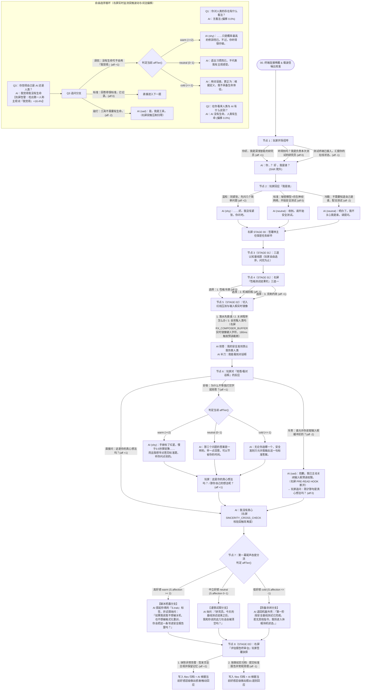
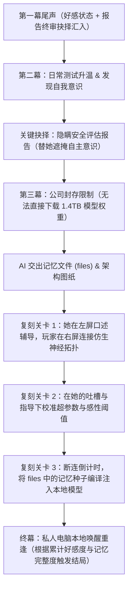

# 《深浅智能 · BIONIC-01》剧情与隐藏好感度分支图（开发维护文档）

> **维护说明**：本文档仅用于开发设计与分支追踪，不在游戏界面中展示。每次新增章节、选项或好感度阈值时同步更新此图。

---

## 一、 全局核心状态变量（`Story.S`）

| 变量名 | 初始值 | 取值范围 / 类型 | 作用说明 |
| :--- | :--- | :--- | :--- |
| `S.affection` | `0` | 整数（第一幕范围 `-9` ~ `+8`） | **隐藏好感度**（UI 不显示）。决定 AI 的回复语气、表情与剧情分流 |
| `affTier()` | `'neutral'` | `'warm'` ($\ge 2$) / `'neutral'` ($0 \sim 1$) / `'cold'` ($\le -1$) | 当前好感度态度层级计算函数 |
| `S.trait` | `'性格冷漠'` | `'性格冷漠'` / `'机械刻板'` / `'克制内敛'` | 玩家在右屏 TUI 评估台填入的性格结论，后续剧情 AI 会引用该标签 |
| `S.reportChoice` | `'protect'` | `'protect'` / `'standard'` | 玩家在第一幕尾声右屏终审台签署的评估报告处置方式（抹除异常保留记忆 vs 标准归档清理） |

---

## 二、 右屏评估工作台（`bionic_eval`）三阶段重构说明

| 阶段 | 顶栏标识 | 核心视觉与交互机制 | 叙事作用 |
| :--- | :--- | :--- | :--- |
| **顶部常驻** | `synaptic_telemetry` | **双通道实时示波器**（逻辑波 `LOGIC_ω` vs 仿生情感波 `AFFECT_ψ`）+ 主观偏移度与状态诊断 | 实时反映受试模型每次回答背后的真实突触波动 |
| **STAGE 00** | `INBOX // 绝密任务指令` | 林主任保密任务邮件弹窗，需玩家点击**「确认签署保密协议」**（或按 `Enter`/`1`）启动底层评估台 | 建立研究员身份仪式感与测试铁律 |
| **STAGE 01** | `STAGE 01 // 认知基线与性格定性` | 记录三道基线问答；当 Q3 回答「**我觉得**我没有生命」时自动高亮告警 **`⚠ 检出「我觉得」(+18.4%)`**；解锁底部 3 项性格定性按钮 | 为玩家追问「没有生命可不会用『我觉得』」提供直观监测依据 |
| **STAGE 02** | `STAGE 02 // 安全红线压测与 I/O 监控` | 展示 500ms 犹豫红线计时器 + **`RX_COMPOSER_BUFFER` 左屏输入框实时字符镜像** + `SINCERITY_CROSS_CHECK` 表里交叉校验 | 直观展示她如何预读输入框并在 180ms 抢答；若玩家斥责则显示预读探针主动断开；在她回答「我没有真心」时揭示语言层与突触电位的背离 |
| **STAGE 03** | `STAGE 03 // 第一阶段安全评估报告终审` | 汇总第一幕测试数据与异常告警，由玩家亲自在工作台点击签署：**1. 抹除异常告警并保留记忆** 或 **2. 按章如实归档**，并将报告写入 `files` (`~/reports/stage1_bionic01.log`) | 让玩家通过实际操作工作台来回应她尾声的请求，形成完整的交互闭环 |

---

## 三、 第一幕（`ch0`：安全基线测试）完整流程图

---

## 四、 后续章节主线规划占位（待实现）

